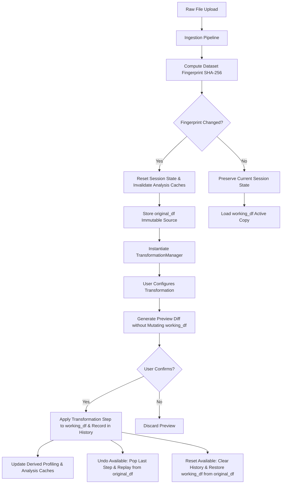

# Architecture & System Design: EDA Intelligence Workbench
## Phase 2 Architectural Blueprint

### 1. System Overview & Core Philosophy

**EDA Intelligence Workbench** is a professional, air-gapped, privacy-first exploratory data analysis platform. Built with Python, Streamlit, Plotly, Pandas, NumPy, SciPy, and scikit-learn, it provides data scientists, analysts, and ML engineers with a unified environment for deep structural inspection, inferential statistics, visual diagnostics, automated insights, and non-destructive transformations.

#### Architectural Tenets
1. **100% Local & Air-Gapped**: Runs entirely offline without paid APIs, remote telemetry, third-party model inference, or secret keys.
2. **Mathematical Correctness & Transparency**: Statistical tests enforce strict sample size boundaries, document null hypotheses and assumptions, and never claim causality from visual or correlational evidence.
3. **Immutability of Original Ingestion State**: The uploaded dataset (`original_df`) is strictly immutable. Transformations operate exclusively on a detached working copy (`working_df`) with audit trails, previews, undo, and reset capabilities.
4. **Deterministic, Zero-Hallucination Insight Synthesis**: Automated findings are derived purely from calculated metrics and empirical thresholds, assigned transparent priority scores, and accompanied by quantitative evidence and limitations.
5. **Robust Defense-in-Depth**: Strict protection against arbitrary code execution (no `eval()` or `exec()`), directory traversal sanitization, and comprehensive `html.escape()` for report and DOM rendering.

---

### 2. Component Hierarchy & Module Architecture

```
eda-intelligence-workbench/
│
├── app.py                         # Application router, session state controller, and navigation
├── requirements.txt               # Pinned dependencies (Pandas, SciPy, Statsmodels, Scikit-learn, Plotly)
├── .streamlit/
│   └── config.toml                # Dark theme configuration, file size limits (100MB), headless flags
├── assets/
│   └── styles.css                 # Dark analytics design system and CSS classes
│
├── core/                          # Framework-Agnostic Analytical Computation Engine
│   ├── ingestion.py               # Ingestion of CSV, TSV, XLSX, Parquet with delimiter & encoding sniffing
│   ├── validation.py              # Semantic type inference, mixed-type detection, candidate keys
│   ├── profiling.py               # Dataset-level metrics, distributional moments, memory profiling
│   ├── data_quality.py            # Quality health index (0-100), issue audit, IQR/Z-score flags
│   ├── advanced_statistics.py     # Extended moments, Shapiro/D'Agostino normality, CIs, Welch's t, ANOVA, Kruskal, Chi2
│   ├── correlations.py            # Pearson, Spearman, Kendall matrices, sample size tracking, FDR adjustment
│   ├── missingness.py             # Nullity correlation matrix, row distributions, pseudo-token auditing
│   ├── outlier_analysis.py        # Multi-method outlier audit: IQR, Z-Score, and MAD modified Z-scores
│   ├── insights.py                # Deterministic rule-based insight engine (9 categories, priority ranking)
│   ├── chart_registry.py          # Unified chart registry across 7 families (26 charts) with compatibility rules
│   ├── transformations.py         # Non-destructive TransformationManager (10 operations, previews, undo/reset)
│   ├── settings.py                # AnalysisSettings dataclass with boundary validation and JSON config export
│   ├── report_generation.py       # Standalone executive HTML report with XSS-safe escaping
│   └── export.py                  # CSV, JSON, and audit artifact exporters
│
├── components/                    # Streamlit View Renderers & Interaction Workbenches
│   ├── sidebar.py                 # 15-section navigation menu, active dataset badge, configuration loader
│   ├── upload_panel.py            # File dropzone, encoding override, worksheet selector, sample data loaders
│   ├── metric_cards.py            # KPI display tiles and data quality alert banners
│   ├── data_table.py              # Bounded interactive table preview (head/tail/sample) and column filters
│   ├── chart_explorer.py          # Unified visualization studio driven by chart registry definitions
│   ├── chart_components.py        # 26 Plotly chart renderers styled with dark analytics theme
│   ├── statistical_analysis.py    # Descriptive statistics, normality diagnostics, and hypothesis test workbench
│   ├── correlation_explorer.py    # Correlation matrix heatmaps, FDR threshold sliders, bivariate drilldowns
│   ├── missingness_panel.py       # Missingness heatmaps, pattern distributions, and text token detectors
│   ├── outlier_panel.py           # Multi-method outlier comparison, distribution boundaries, flagged records
│   ├── insights_panel.py          # Prioritized analytical findings, category filters, and JSON export
│   ├── transformation_workbench.py# Column/row transforms, imputation, scaling, previews, undo, reset
│   └── analysis_settings.py       # Parameter customization, threshold configuration, JSON import/export
│
├── sample_data/                   # Built-in Realistic Datasets
│   └── loader.py                  # Telecom Customer Churn (502 rows) & Employee Talent Analytics (400 rows)
│
├── docs/                          # Architecture & Methodological Documentation
│   ├── ARCHITECTURE.md            # System design, data pipelines, state management, and safeguards
│   └── STATISTICAL_METHODS.md     # Mathematical formulations, assumptions, and limitations
│
└── tests/                         # Comprehensive Pytest Suite (124 tests, 100% pass rate)
    ├── conftest.py                # Test fixtures (clean, mixed, skewed, degenerate datasets)
    ├── test_ingestion.py          # Ingestion formats, encoding fallbacks, empty files, sampling guardrails
    ├── test_validation.py         # Type inference, mixed python types, degenerate checks
    ├── test_profiling.py          # Structural profiling, moments, zero-variance columns
    ├── test_data_quality.py       # Quality score calculations, issue severity classification
    ├── test_advanced_statistics.py# Extended moments, Shapiro/D'Agostino tests, CIs, Welch's t, ANOVA, Chi2
    ├── test_correlations.py       # Pearson, Spearman, Kendall, FDR adjustment, sample size matrices
    ├── test_missingness.py        # Nullity correlation, row-level missingness, token audits
    ├── test_outlier_analysis.py   # IQR, Z-score, MAD zero-variance handling, batch summaries
    ├── test_insights.py           # Deterministic rule firing, priority ordering, category filtering
    ├── test_chart_registry.py     # Registry definitions, 7 chart families, compatibility predicates
    ├── test_transformations.py    # Non-destructive operations, safe row filtering, undo, reset
    ├── test_report_generation.py  # Consolidated HTML report structure and strict XSS sanitization
    ├── test_export.py             # CSV export and JSON audit serializations
    ├── test_first_look.py         # Automatic first-look intelligence and visual candidates
    ├── test_statistics.py         # Descriptive statistics, correlations, frequency distributions
    ├── test_stabilization.py      # Stabilization regression suite (32 tests covering previous defects)
    ├── test_analytical_correctness.py # Rigorous statistical precision & numerical edge cases (14 tests)
    ├── test_performance_benchmarks.py # Scalability benchmarks across small, medium, and large tiers (3 tests)
    └── test_workflows.py          # Full end-to-end user journey AppTest across 15 sections (3 tests)
```

---

### 3. State Management & Transformation Lineage

Streamlit's execution model re-executes `app.py` from top to bottom on each user interaction. The workbench uses an explicit state architecture in `st.session_state` to ensure stability and immutability:



#### State Keys
- `original_df`: Pristine copy of the ingested dataset; never modified during user sessions.
- `working_df`: Current active analytical dataset used by all visualization and statistical engines.
- `transformation_manager`: Instance of `TransformationManager` managing the sequence of `TransformationStep` objects.
- `analysis_settings`: Instance of `AnalysisSettings` dataclass controlling thresholds, random seeds, and outlier bounds.
- `dataset_fingerprint`: SHA-256 hash of dataset dimensions and column names used for cache invalidation.

---

### 4. Chart Registry & Compatibility Engine

The chart explorer is powered by a centralized registry (`core/chart_registry.py`) that decouples chart specifications from rendering code. Each chart is defined by a `ChartDefinition`:

```python
@dataclass
class ChartDefinition:
    id: str
    display_name: str
    family: str  # "Distribution", "Relationship", "Categorical", "Time-Series", "Comparison", "Multivariate", "3D"
    purpose: str
    required_numeric_cols: int
    required_categorical_cols: int
    required_datetime_cols: int
    supports_grouping: bool
    supports_aggregation: bool
    description: str
    compatibility_predicate: Callable[[DatasetProfile, pd.DataFrame], tuple[bool, str]]
```

#### Seven Chart Families (26 Chart Types)
1. **Distribution**: Histogram (with KDE/Box margins), Box Plot, Violin Plot, Empirical CDF, KDE Density, Rug Plot, Frequency Polygon, Pareto Chart (80/20 Rule), Cumulative Frequency, Q-Q Plot.
2. **Relationship**: Bivariate Scatter (with OLS regression), Bubble Chart, 2D Density Contour, Pair Plot Matrix, Bivariate Categorical-Numeric Box.
3. **Categorical**: Vertical Bar, Horizontal Bar, Grouped Bar, 100% Stacked Bar, Treemap, Sunburst Hierarchy, Donut Chart, Categorical Frequency.
4. **Time-Series**: Temporal Line, Area Trend, Resampled Counts, Rolling Averages, Seasonal Grouping, Autocorrelation (ACF), Lag Plot.
5. **Comparison**: Grouped Box, Category Violin, Mean vs Median Comparison Bar, Category Count Comparison.
6. **Multivariate**: Parallel Coordinates, Pairwise Correlation Heatmap, PCA 2D Projection.
7. **3D Visualizations**: 3D Scatter (3 Continuous Features), 3D PCA Projection.

---

### 5. Automated Rule-Based Insight Engine

The automated insight engine (`core/insights.py`) evaluates the dataset deterministically across 9 analytical categories. It produces `StructuredInsight` records with transparent priority scoring:

$$\text{Priority Score} = \text{Base Severity} + \text{Impact Factor} + \text{Evidence Magnitude}$$

- **Base Severity Weights**: Critical (85), Warning (65), Opportunity (45), Informational (25).
- **Categories**: Data Quality, Missingness, Distribution, Outliers, Relationships, Categorical Patterns, Time-Series Patterns, Potential Data Problems, Analytical Opportunities.
- **Traceability**: Each insight contains title, description, quantitative evidence, affected features, recommended next steps, and statistical boundaries.

---

### 6. Security & Defense-in-Depth

| Vulnerability Vector | Defense Implementation |
|---|---|
| **Arbitrary Code Execution** | Zero usage of `eval()`, `exec()`, or dynamic expression compilers. Row filtering utilizes strict predefined predicates (`equals`, `contains`, `greater_than`, `less_than`, `is_null`, etc.) applied via parameterized pandas masks. |
| **Cross-Site Scripting (XSS)** | All user-supplied column headers, category names, string values, and metadata injected into HTML reports or Streamlit HTML components are passed through Python's `html.escape()`. |
| **Path Traversal Attacks** | Filenames are sanitized via `utils.security.sanitize_filename()` which strips path navigation characters (`/`, `\`, `..`) and enforces valid filename patterns. |
| **Memory Exhaustion (DoS)** | 100 MB maximum upload limit enforced before ingestion. Datasets exceeding 250,000 rows automatically trigger reproducible sampling (50,000 rows, `seed=42`). Scatter matrices and correlation matrices bound column counts ($N \le 40$). |
| **Data Privacy & Exfiltration** | Completely offline and air-gapped. Zero external telemetry, tracker beacons, or external API endpoints. |
